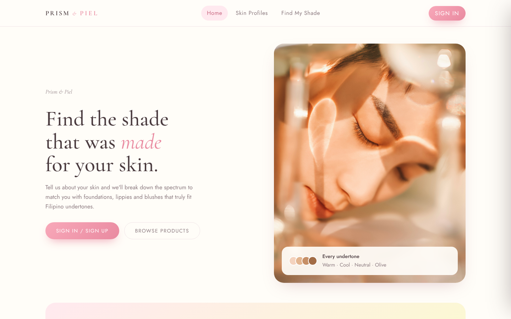
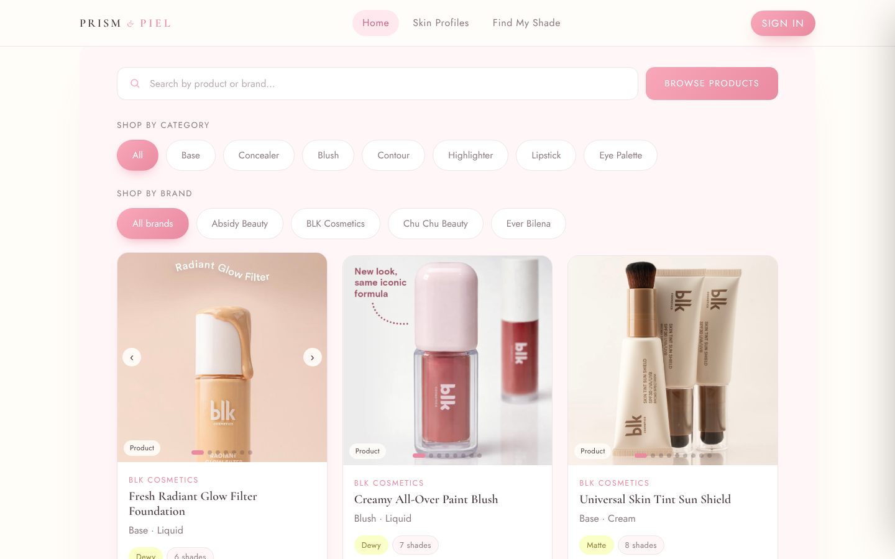
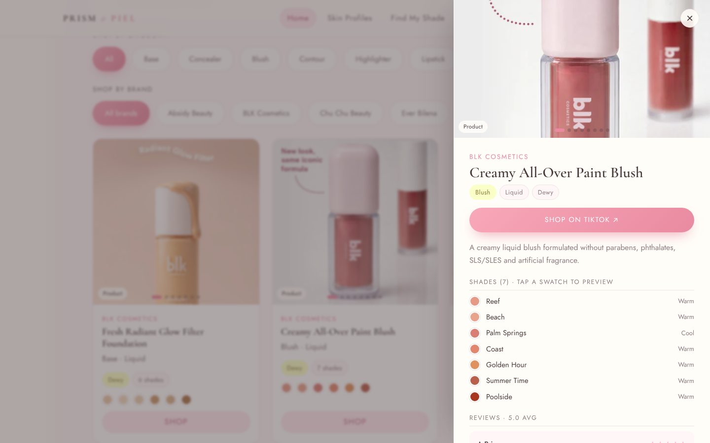
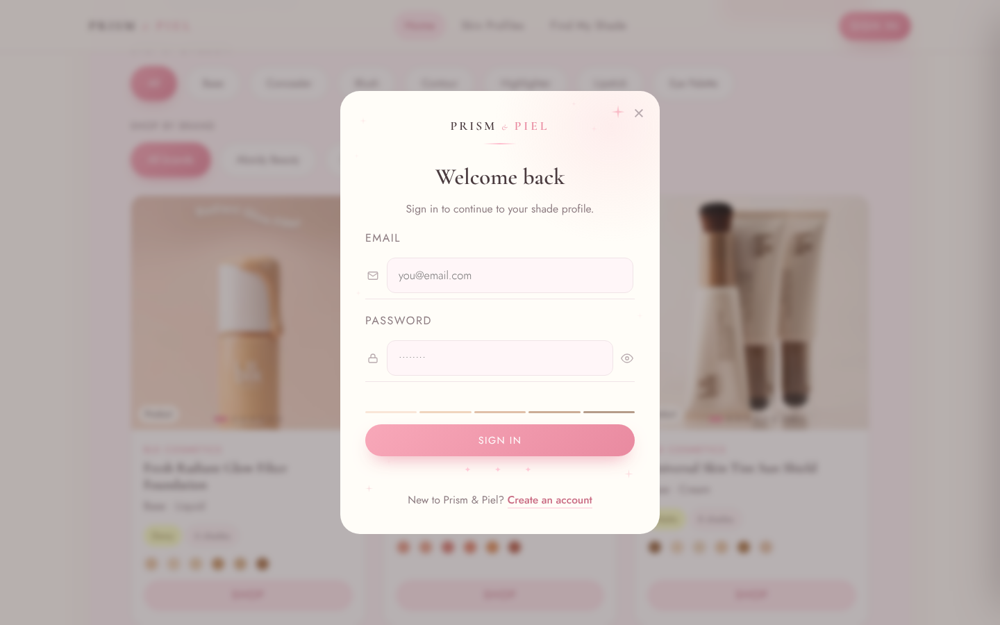
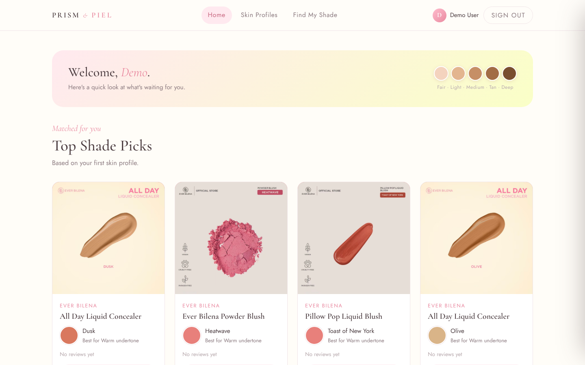
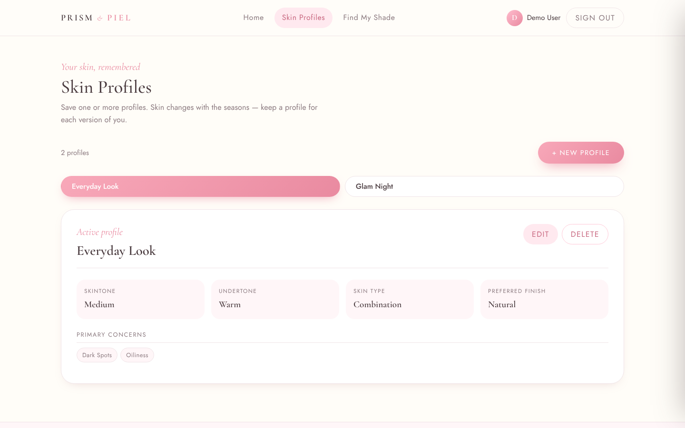
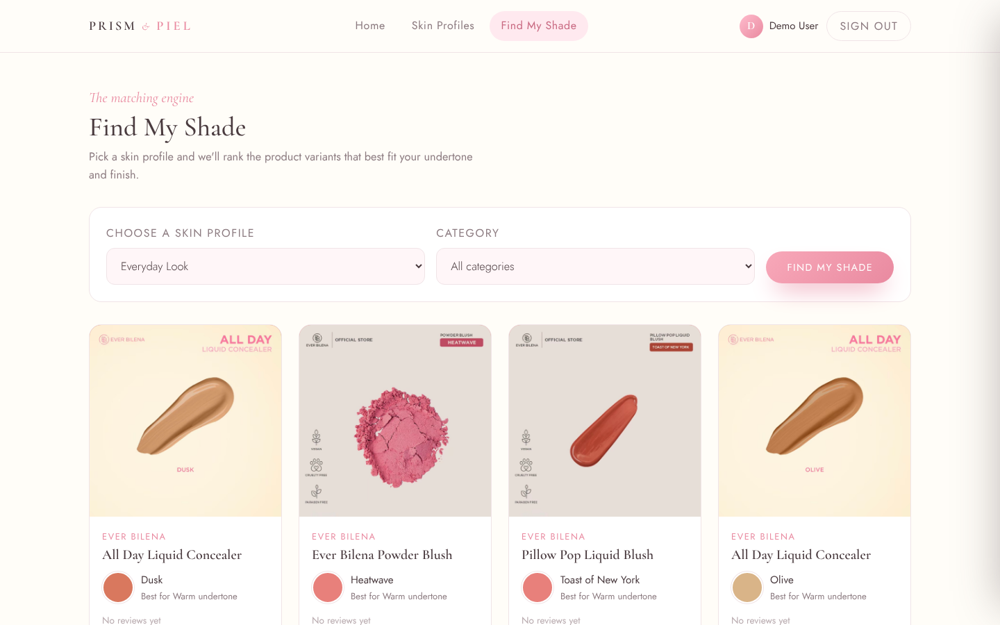
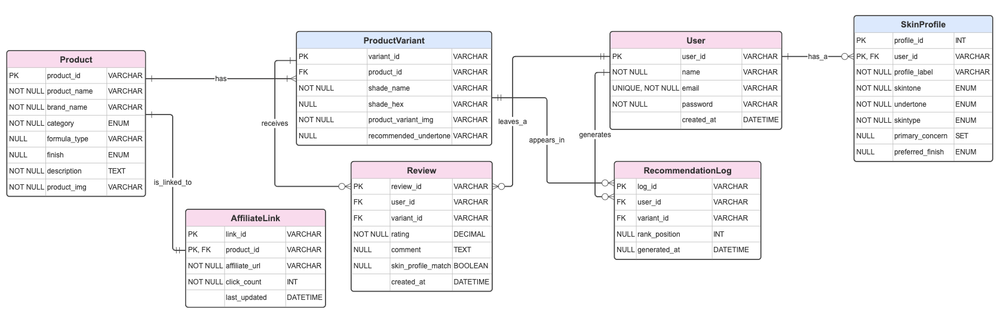

# Prism & Piel

> Find the shade that was made for your skin.

Prism & Piel is a shade-matching web app for Filipino skin. You save a skin profile (skintone, undertone, skin type, preferred finish), and the app ranks real product shades from local and indie beauty brands that fit it.

**This is a database project first.** The point of the app is the relational schema behind it: seven normalized MySQL tables, a weak entity, surrogate keys, enforced foreign keys and a recommendation query built on joins and aggregates. The frontend exists to show that data in action.

**Prism & Piel does not sell anything.** There is no cart or checkout. Every "Shop" button is a **TikTok Shop affiliate link** stored in the `AffiliateLink` table, which sends you to the product's TikTok Shop listing.



---

## The idea

Most shade finders are built around Western skin tones and big global brands. Filipino skin usually sits in the light-to-tan range with warm, neutral or olive undertones, and the brands people actually buy here (BLK Cosmetics, Ever Bilena, Absidy Beauty, Chu Chu Beauty) are sold through TikTok Shop.

So the app does three things:

1. **Catalog** real products and every shade they come in, each tagged with the undertone it suits.
2. **Remember** your skin as one or more profiles (an "Everyday Look" and a "Glam Night" can be different).
3. **Match** shades to a profile with a SQL query, log what it recommended, and point you to the TikTok Shop listing if you want to buy.

---

## App walkthrough

### Browse the catalog
Anyone can browse without an account. Filter by category or brand, or search by name. Each card shows the product photo, its finish and every shade as a swatch.



### Product details and the TikTok Shop link
Clicking a product opens a drawer with all its shades, which undertone each one suits, reviews, and the **Shop on TikTok** button that opens the affiliate link.



### Sign in
Sign in or create an account to save skin profiles and get matches.



### Home
After signing in, the home page shows your top shade picks based on your first skin profile.



### Skin profiles
A user can keep several profiles. Each one stores skintone, undertone, skin type, primary concerns and preferred finish.



### Find My Shade
Pick a profile (and optionally a category) and the matching engine ranks the shades that fit. Every result is written to `RecommendationLog`.



---

## The database

### ERD



### Tables

| Table | What it holds | Key design notes |
|---|---|---|
| `User` | Accounts | PK `user_id` (`USR-001`), `email` is `UNIQUE` |
| `SkinProfile` | A user's saved skin profiles | **Weak entity.** Composite PK `(user_id, profile_id)`, can't exist without its `User` |
| `Product` | A product line (e.g. "Creamy All-Over Paint Blush") | `category` and `finish` are `ENUM`s |
| `ProductVariant` | One shade of a product | **Surrogate PK** `variant_id` (`VAR-001`), FK to `Product`, stores `shade_hex` and `recommended_undertone` |
| `AffiliateLink` | The TikTok Shop link for a product | FK to `Product`, tracks `click_count` and `last_updated` |
| `Review` | A user's rating of a specific shade | FKs to `User` and `ProductVariant`, `CHECK (rating BETWEEN 1.0 AND 5.0)` |
| `RecommendationLog` | Every shade the engine recommended to a user | FKs to `User` and `ProductVariant`, stores `rank_position` and `clicked` |

### Relationships

- A **User** has many **SkinProfiles** (1:N, identifying)
- A **Product** has many **ProductVariants** (1:N)
- A **Product** is linked to an **AffiliateLink** (1:1 in the seed data)
- A **User** leaves many **Reviews**, each on one **ProductVariant**
- A **User** generates many **RecommendationLog** rows, each pointing at one **ProductVariant**

All foreign keys use `ON DELETE CASCADE`, so deleting a user removes their profiles, reviews and logs, and deleting a product removes its shades and link.

### Design choices worth pointing out

- **Readable string IDs.** Keys look like `USR-001`, `PRD-001`, `VAR-001`. Since `VARCHAR` keys can't use `AUTO_INCREMENT`, `backend/utils/genId.js` finds the highest existing number for a prefix and generates the next one.
- **Reviews and logs point at a variant, not a product.** A rating for "Golden Hour" says nothing about "Poolside", so feedback is stored at the shade level.
- **`SET` for concerns.** `primary_concern` is a MySQL `SET`, so one profile can hold several concerns (`'Oiliness,Dark Spots'`) without a separate table.

### The matching query

The core of "Find My Shade" is one query in `backend/routes/recommendations.js`:

```sql
SELECT pv.variant_id, pv.shade_name, pv.shade_hex, p.product_name, p.brand_name,
       COALESCE(AVG(r.rating), 0) AS avg_rating,
       COUNT(r.review_id)         AS review_count
FROM ProductVariant pv
JOIN Product p      ON p.product_id = pv.product_id
LEFT JOIN Review r  ON r.variant_id = pv.variant_id
WHERE pv.recommended_undertone = ?           -- profile's undertone
  AND (p.finish = ? OR p.finish IS NULL)     -- profile's preferred finish
GROUP BY pv.variant_id
ORDER BY avg_rating DESC
LIMIT 10;
```

Each returned shade is then inserted into `RecommendationLog` with its rank.

### Seed data

`database/seed.sql` loads:

- 3 users and 3 skin profiles
- 10 products from 4 brands (BLK Cosmetics, Absidy Beauty, Chu Chu Beauty, Ever Bilena)
- 60 shades
- 10 TikTok Shop affiliate links (one per product)
- 6 reviews and a few recommendation log entries

---

## Tech stack

| Layer | Tools |
|---|---|
| Database | MySQL 8 |
| Backend | Node.js, Express 5, `mysql2` |
| Frontend | Plain HTML, CSS and JavaScript (no framework) |

---

## Running it locally

**1. Create the database**

```bash
mysql -u root -p < database/schema.sql
mysql -u root -p < database/seed.sql
```

**2. Configure the backend.** Create `backend/.env`:

```env
DB_HOST=localhost
DB_USER=root
DB_PASS=your_password
DB_NAME=prism_and_piel
DB_PORT=3306
```

**3. Start the server**

```bash
cd backend
npm install
npm start
```

Open http://localhost:3000. The Express server serves the frontend and the API.

**Demo account:** `demo@prism.ph` / `demo`

---

## API

All routes are under `/api`.

| Resource | Endpoints |
|---|---|
| Auth | `POST /auth/login`, `POST /auth/signup` |
| Users | `GET/POST /users`, `GET/PUT/DELETE /users/:id` |
| Skin profiles | `GET/POST /skinprofiles`, `GET /skinprofiles/user/:user_id`, `GET/PUT/DELETE /skinprofiles/:user_id/:profile_id` |
| Products | `GET/POST /products`, `GET /products/category/:category`, `GET/PUT/DELETE /products/:id` |
| Variants | `GET/POST /variants`, `GET /variants/product/:product_id`, `GET/PUT/DELETE /variants/:variant_id` |
| Affiliate links | `GET/POST /affiliatelinks`, `GET /affiliatelinks/product/:product_id`, `GET/PUT/DELETE /affiliatelinks/:id`, `PUT /affiliatelinks/click/:id` |
| Reviews | `GET/POST /reviews`, `GET /reviews/user/:user_id`, `GET /reviews/variant/:variant_id`, `GET/PUT/DELETE /reviews/:id` |
| Recommendations | `GET/POST /recommendations`, `GET /recommendations/user/:user_id`, `POST /recommendations/generate/:user_id`, `PUT /recommendations/click/:id`, `DELETE /recommendations/:id` |

---

## Project structure

```
prism-and-piel/
├── database/
│   ├── schema.sql          # CREATE TABLE statements
│   ├── seed.sql            # sample data
│   └── erd/physical-erd.png
├── backend/
│   ├── server.js           # Express app, serves API + frontend
│   ├── config/db.js        # MySQL connection pool
│   ├── utils/genId.js      # USR-001 style ID generator
│   └── routes/             # one file per table
├── frontend/
│   ├── index.html
│   ├── css/style.css
│   ├── js/                 # app, views, components, api client
│   └── assets/             # product and shade photos
└── docs/screenshots/       # images used in this README
```

---

## Disclaimer

This is a student database project. Prism & Piel isn't affiliated with any of the brands shown. Product names and photos belong to their brands, and shop links go to TikTok Shop affiliate listings.
