<div align="center">

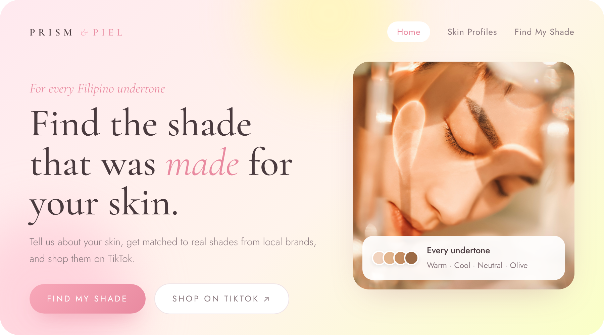

<br>


</div>

<br>

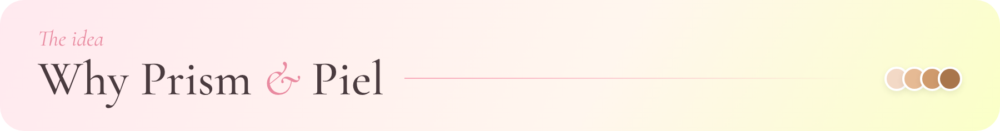

Most shade finders are built for Western skin and global brands. Filipino skin lives in the light-to-tan range with warm, neutral and olive undertones, and the brands we actually buy are sold on TikTok Shop. **Prism & Piel matches you to those shades and sends you straight to the listing.**

<br>

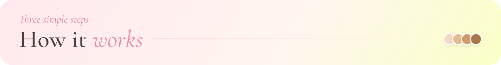

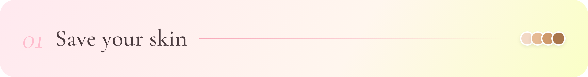

Skintone, undertone, skin type and finish. Keep a profile for every look, like an Everyday Look and a Glam Night.

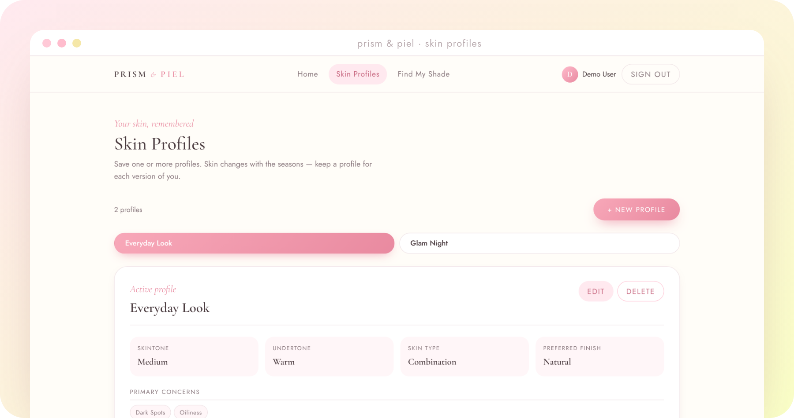

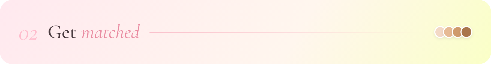

Pick a profile and Prism & Piel ranks every shade that fits your undertone and finish.

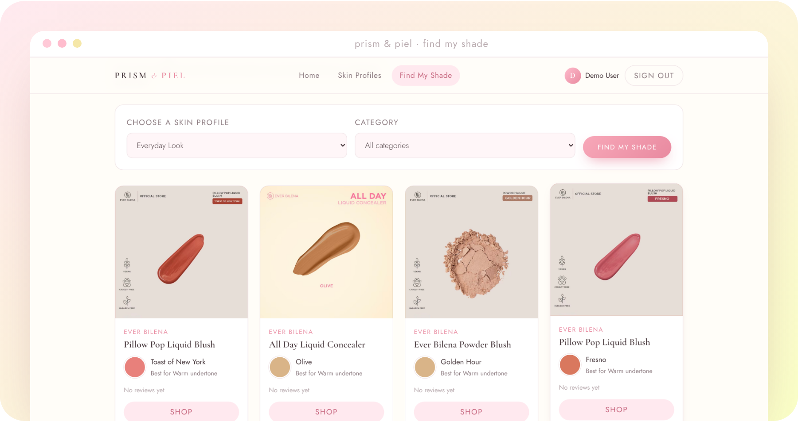

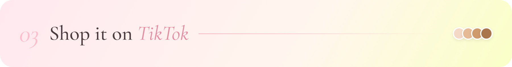

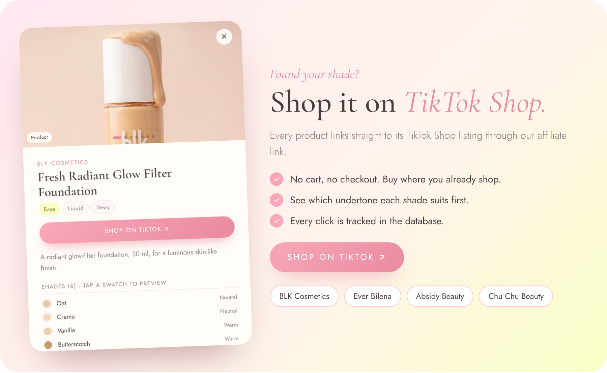

<br>

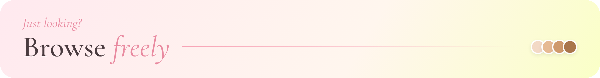

No account needed. Filter by category or brand, swipe through every shade, and shop. Sign in and your home page shows your top picks.

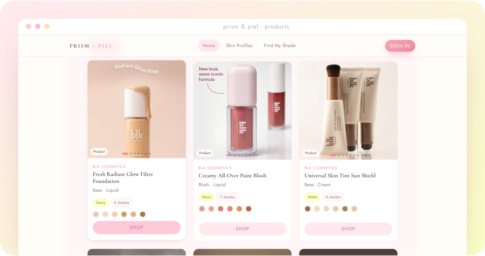

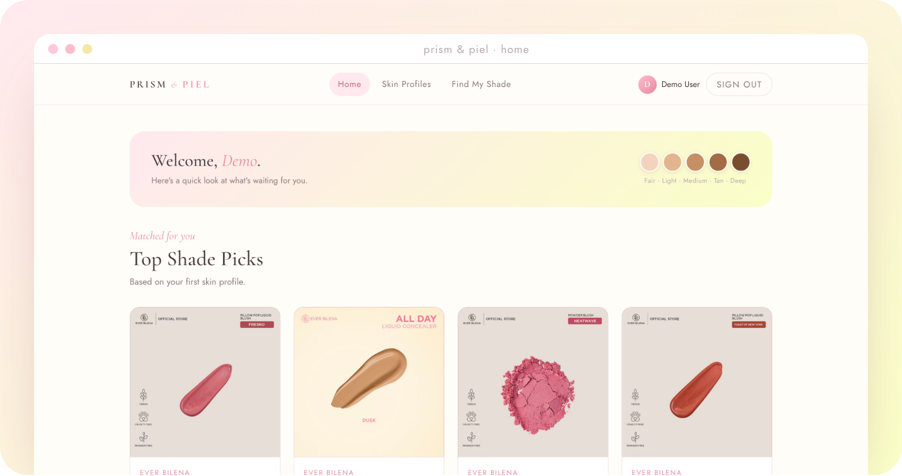

<br>

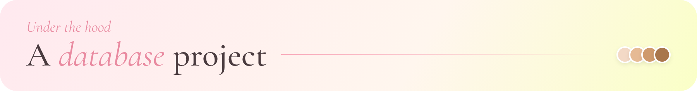

Prism & Piel runs on a relational MySQL database. Products, shades, skin profiles, reviews, recommendations and TikTok Shop links live in **7 normalized tables**, and the shade matching is a single SQL query.


<details>
<summary><b>Tables</b></summary>

| Table | Holds |
|---|---|
| `User` | Accounts |
| `SkinProfile` | Saved skin profiles (weak entity, PK `user_id + profile_id`) |
| `Product` | Product lines |
| `ProductVariant` | Each shade, with hex color and best undertone |
| `AffiliateLink` | The TikTok Shop link and click count for each product |
| `Review` | Ratings per shade |
| `RecommendationLog` | Every shade recommended to a user, with rank |

</details>

<details>
<summary><b>The matching query</b></summary>

```sql
SELECT pv.variant_id, pv.shade_name, p.product_name, p.brand_name,
       COALESCE(AVG(r.rating), 0) AS avg_rating
FROM ProductVariant pv
JOIN Product p     ON p.product_id = pv.product_id
LEFT JOIN Review r ON r.variant_id = pv.variant_id
WHERE pv.recommended_undertone = ?
  AND (p.finish = ? OR p.finish IS NULL)
GROUP BY pv.variant_id
ORDER BY avg_rating DESC
LIMIT 10;
```

</details>

<details>
<summary><b>Run it locally</b></summary>

```bash
mysql -u root -p < database/schema.sql
mysql -u root -p < database/seed.sql
```

Create `backend/.env`:

```env
DB_HOST=localhost
DB_USER=root
DB_PASS=your_password
DB_NAME=prism_and_piel
```

```bash
cd backend
npm install
npm start
```

Open http://localhost:3000 and sign in with `demo@prism.ph` / `demo`.

</details>

<br>


