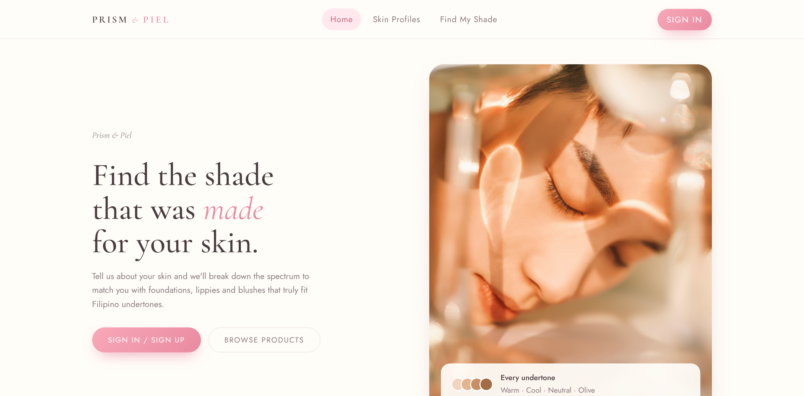
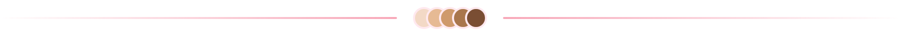

<div align="center">


# Prism & Piel

**Find the shade that was made for your skin.**

Shade matching for Filipino undertones. Tell us your skin, get matched, shop it on TikTok.

</div>





## Why Prism & Piel

Most shade finders are built for Western skin and global brands. Filipino skin lives in the light-to-tan range with warm, neutral and olive undertones, and the brands we actually buy are sold on TikTok Shop. **Prism & Piel matches you to those shades and sends you straight to the listing.**


## How it works

### 1. Save your skin

Skintone, undertone, skin type and finish. Keep a profile for every look, like an Everyday Look and a Glam Night.


### 2. Get matched

Pick a profile and Prism & Piel ranks every shade that fits your undertone and finish.


### 3. Shop it on TikTok Shop

Found your shade? Hit **Shop on TikTok** and you land on the product's **TikTok Shop** listing through our affiliate link.

- No cart, no checkout. Buy where you already shop.
- See which undertone each shade suits before you buy.
- Every click is tracked in the database.

**Brands:** BLK Cosmetics · Ever Bilena · Absidy Beauty · Chu Chu Beauty


## Browse freely

No account needed. Filter by category or brand, swipe through every shade, and shop.


Sign in and your home page shows your top picks right away.


## A database project

Prism & Piel runs on a relational MySQL database. Products, shades, skin profiles, reviews, recommendations and TikTok Shop links live in **7 normalized tables**, and the shade matching is a single SQL query.


<details>
<summary><b>Tables</b></summary>

| Table | Holds |
|---|---|
| `User` | Accounts |
| `SkinProfile` | Saved skin profiles (weak entity, PK `user_id + profile_id`) |
| `Product` | Product lines |
| `ProductVariant` | Each shade, with hex color and best undertone |
| `AffiliateLink` | The TikTok Shop link and click count for each product |
| `Review` | Ratings per shade |
| `RecommendationLog` | Every shade recommended to a user, with rank |

</details>

<details>
<summary><b>The matching query</b></summary>

```sql
SELECT pv.variant_id, pv.shade_name, p.product_name, p.brand_name,
       COALESCE(AVG(r.rating), 0) AS avg_rating
FROM ProductVariant pv
JOIN Product p     ON p.product_id = pv.product_id
LEFT JOIN Review r ON r.variant_id = pv.variant_id
WHERE pv.recommended_undertone = ?
  AND (p.finish = ? OR p.finish IS NULL)
GROUP BY pv.variant_id
ORDER BY avg_rating DESC
LIMIT 10;
```

</details>

<details>
<summary><b>Run it locally</b></summary>

```bash
mysql -u root -p < database/schema.sql
mysql -u root -p < database/seed.sql
```

Create `backend/.env`:

```env
DB_HOST=localhost
DB_USER=root
DB_PASS=your_password
DB_NAME=prism_and_piel
```

```bash
cd backend
npm install
npm start
```

Open http://localhost:3000 and sign in with `demo@prism.ph` / `demo`.

</details>


<div align="center">
<sub>A student database project. Not affiliated with any brand shown. Product names and photos belong to their brands.</sub>
</div>
